<p align="center">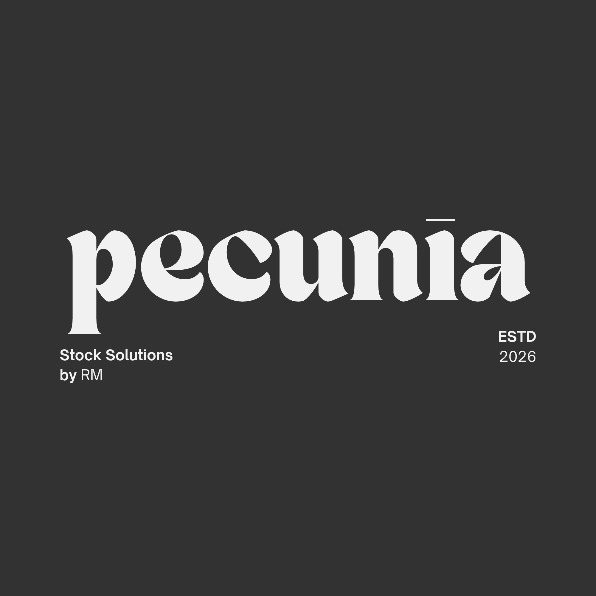</p>

# Pecunia

**Did my stock picks actually beat the market, or did I just add money in a bull run?**

Pecunia pulls your real trade history from Webull (read-only), rebuilds your portfolio day by day, and answers that question honestly. It "shadows" every deposit into the S&P 500, the Nasdaq-100 or any ticker **on the exact same dates, with the exact same amounts**, then compares time-weighted and money-weighted returns.

**[▶ Live demo](https://raghav64.github.io/pecunia/)**: the full interactive report (all six pages, charts, calculators, 50 precomputed tickers) built from a real account. Dollar amounts and share counts are scaled; percentages and market prices are real. Analyzing new tickers and live refresh need the local server (`./serve.sh`).

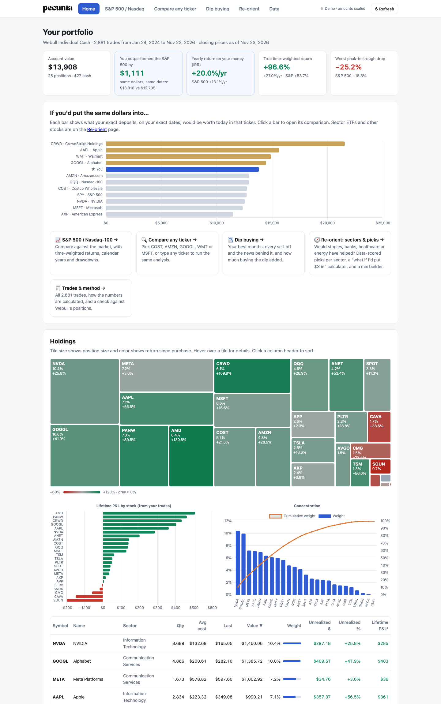

## Why

Broker apps show "return" as unrealized P&L ÷ cost basis. If you've been adding money steadily, that number says little: dollars added last month haven't had time to grow. Comparing against "the S&P 500 is up 47% since I started" is just as misleading, because most of your money wasn't there at the start.

Pecunia uses three measures that do work:

| Measure | Question it answers |
|---|---|
| **Shadow portfolio** | If every dollar I put in had gone into SPY (or COST, or NVDA…) on the same day, what would I have now? |
| **Time-weighted return** | How good were my *picks*, ignoring when I added money? |
| **Money-weighted return (IRR)** | What yearly return did *my actual dollars* earn? |

## Features

| Page | What it does |
|---|---|
| **Home** | Value, IRR, TWR, drawdown, a "same dollars into…" leaderboard, holdings treemap, concentration and sector breakdown, auto-generated observations |
| **S&P 500 / Nasdaq** | Dollar-for-dollar shadow, who's ahead over time, TWR by period, calendar years, drawdowns |
| **Compare any ticker** | Same shadow analysis for any symbol (run live via the local server) |
| **Dip buying** | Best months for new money, every ≥5% sell-off with the news behind it, and how much buying the dip added (timing edge vs the 3-month average price) |
| **Re-orient** | Sector ETFs and data-scored picks (risk-adjusted return, consistency, drawdown, correlation with *your* portfolio), a "what if I'd put $X in" calculator, and a mix builder that replays your history with a different allocation |
| **Data** | Full trade log, method notes, and a reconciliation of rebuilt share counts against the broker |

<p>
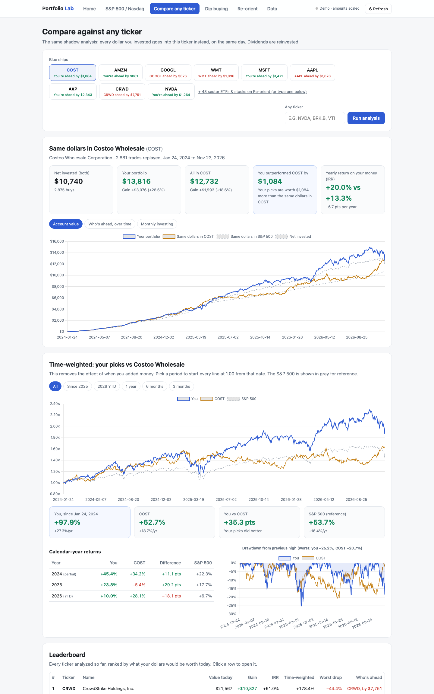 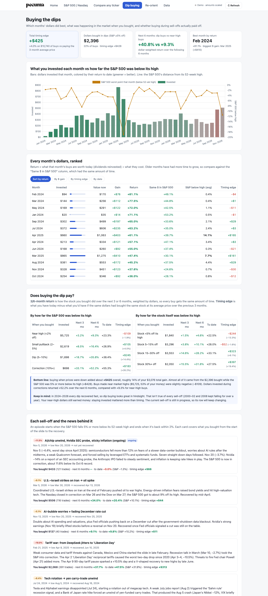
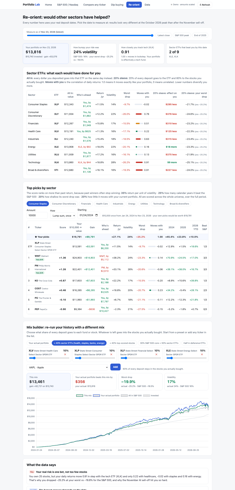 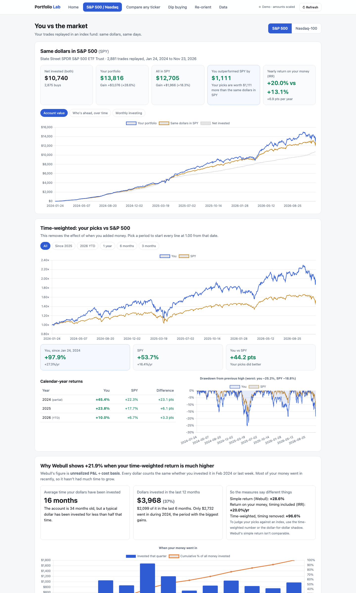
</p>

## The app (v2): live dashboard

A React dashboard on a small Node API: live portfolio value, the S&P 500 and Nasdaq today, a watchlist, positions marked to live prices, sector allocation and your lead over the S&P 500. It has light and dark themes, an icon rail with an analysis menu, and a Refresh panel that streams progress. Every analysis page (S&P 500 / Nasdaq, Compare any ticker, Dip buying, Re-orient, Trades & data) runs natively in React; type any ticker on Compare and the server runs the analysis live.

<p>
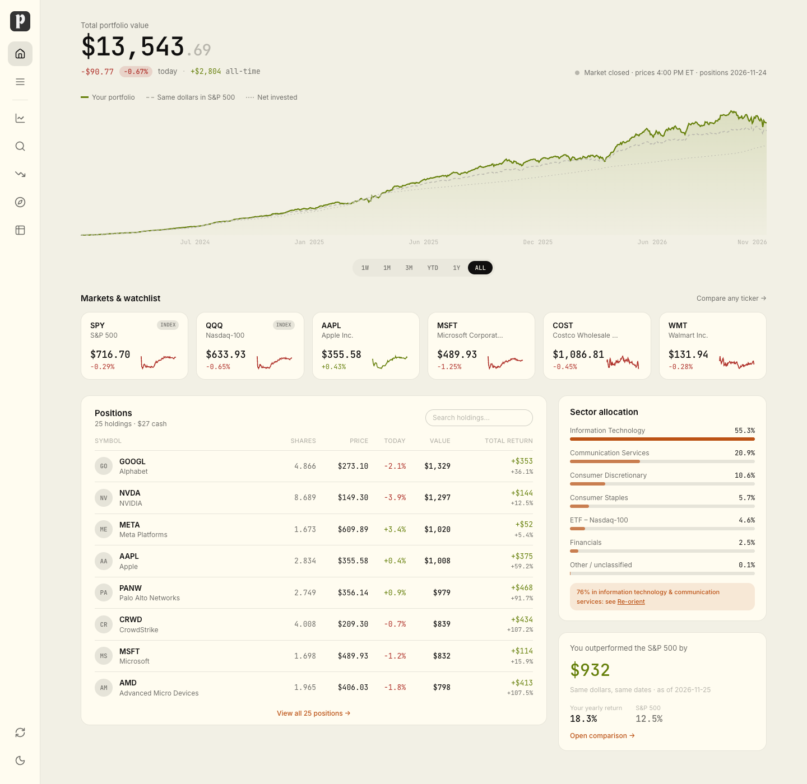 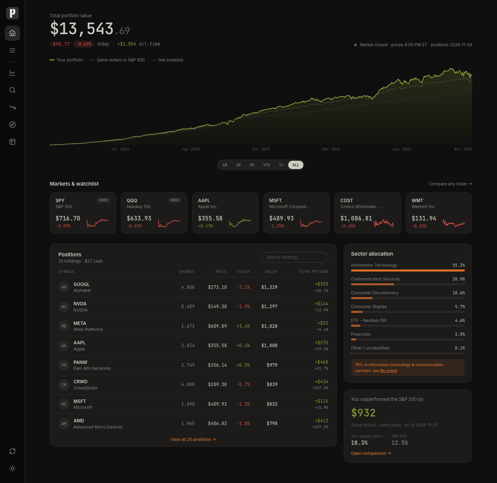
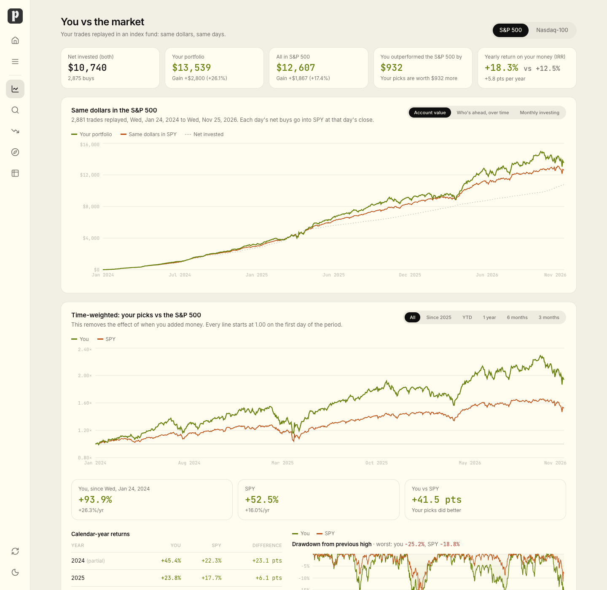 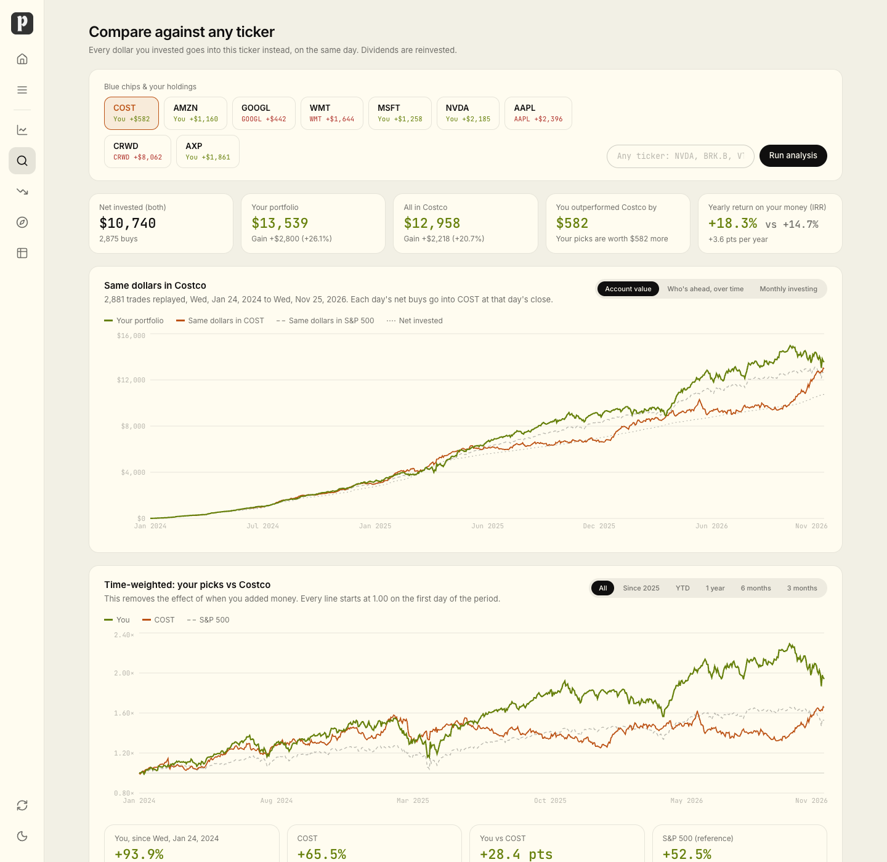
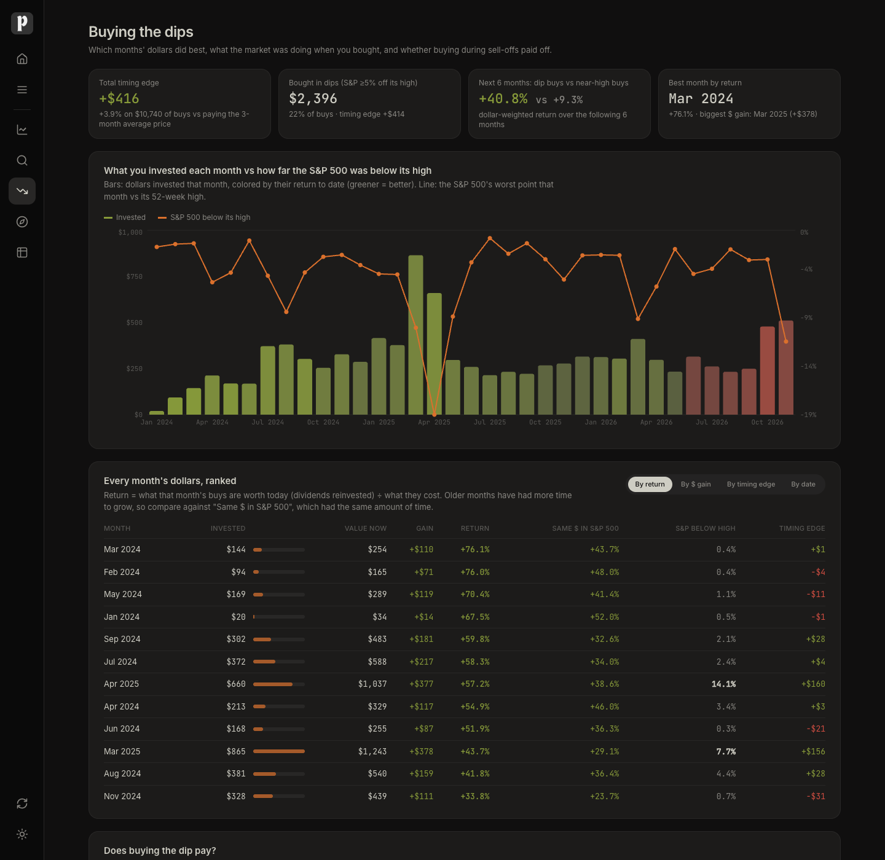 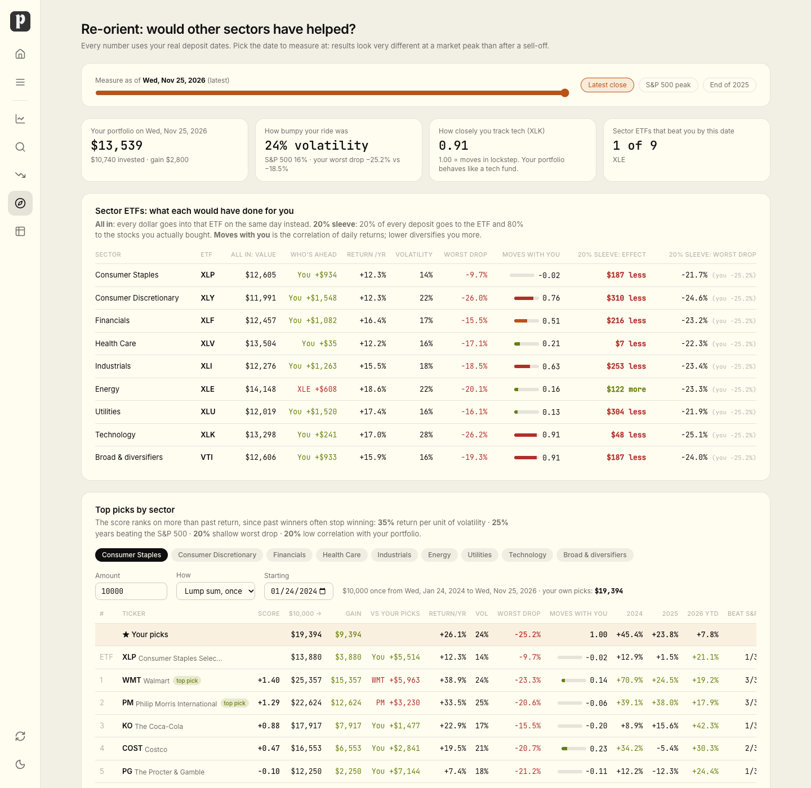
</p>

Design: Figma mocks and tokens in [`assets/figma`](assets/figma) · architecture in [`system-design/`](system-design/README.md).

## How it works

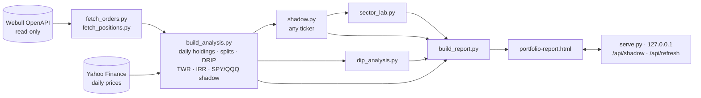

- **Rebuild**: filled orders → daily share counts, with splits applied to older trades and dividends reinvested on the ex-date. The rebuilt positions are checked against the broker's.
- **Shadow**: each day's net buys go into the benchmark at that day's adjusted close; sells come out.
- **TWR**: daily `V_t / (V_{t-1} + flow_t)`, multiplied together. **IRR**: solved by bisection on the actual cash flows.
- **Read-only**: only `list_order_history`, `get_account_position`, `get_account_balance` and `get_account_list` are called. Trading tools are disabled.

## Quick start

Requirements: [uv](https://docs.astral.sh/uv/) (Python), a Webull OpenAPI app key, macOS/Linux.

```bash
export WEBULL_APP_KEY=...  WEBULL_APP_SECRET=...   # WEBULL_ACCOUNT_ID optional (auto-detected)
./run.sh                    # fetch → analyze → build portfolio-report.html (and the data the app reads)

# v2 app (Node 20.19+ / 22.12+)
npm install
npm run dev                 # API on :8787 + React on http://127.0.0.1:5173
npm run build && npm start  # production: one server on http://127.0.0.1:8787

./serve.sh                  # v1 single-page report with "compare any ticker" and Refresh
uv run python scripts/shadow.py COST NVDA BRK.B    # shadow analysis from the terminal
uv run python scripts/make_demo.py                 # rebuild the scaled public demo in docs/
```

Your data stays local: `data/`, `build/` and the generated report are git-ignored.

## System design

High-level design, component write-ups, request flows and the API guide are in [`system-design/`](system-design/README.md).

## Project layout

```
scripts/        pipeline (fetch → analyze → report), v1 server, demo builder
server/         v2 Node API (Hono): live quotes, positions, SSE stream, refresh jobs
web/            v2 React app (Vite, Tailwind, TanStack Query, Recharts)
config/         shared instrument → sector map
docs/           public demo build (GitHub Pages) + screenshots
assets/figma/   dashboard redesign mocks
system-design/  HLD, components, request flows, API guide
run.sh          full refresh   ·   serve.sh   local app
```

## License

[MIT](LICENSE)

---
For informational and educational purposes only. Not investment advice.
