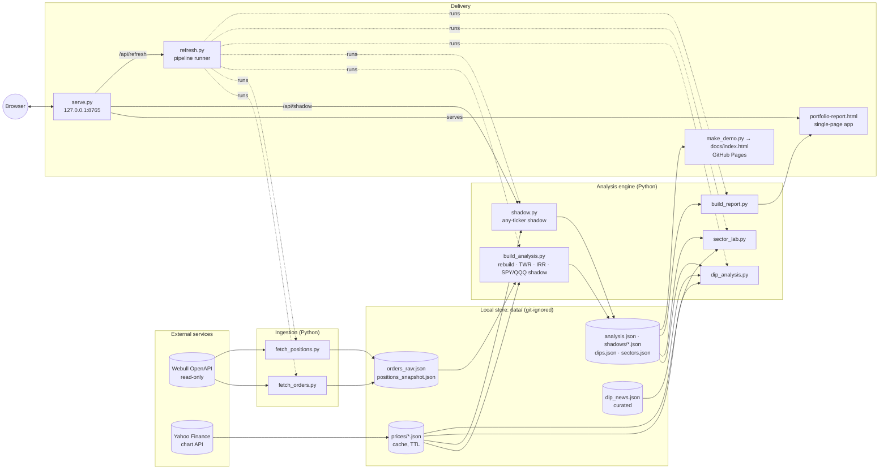
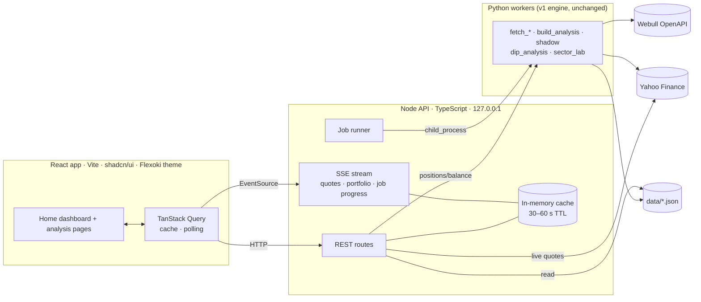

# Pecunia: System Design

| Doc | Contents |
|---|---|
| [README.md](README.md) | Goals, constraints, high-level design (current v1 and planned v2) |
| [components.md](components.md) | Every component: responsibility, inputs/outputs, key decisions |
| [request-flows.md](request-flows.md) | Sequence diagrams for each request path |
| [api.md](api.md) | API reference: v1 endpoints (implemented) and v2 endpoints (planned) |

## Goals
1. Measure portfolio performance **fairly**: dollar-for-dollar shadows, time-weighted return (TWR) and money-weighted return (IRR), not broker "return on cost".
2. Use the user's **real trade history**, pulled read-only from the broker.
3. **Private by default**: everything runs on the user's machine; a scaled demo can be published.
4. Interactive analysis: compare against any ticker, dip-buying, sector re-orientation.

## Constraints
- **Read-only broker access.** Only order history, positions, balance and account list are called; the trading toolset is disabled.
- **No broker deposit/transfer API**, so net buys and sells stand in for cash flows.
- **Broker market data needs a paid subscription**, so prices come from Yahoo Finance daily bars (cached).
- **Broker API rate limits (HTTP 429)** are aggressive, so calls use exponential backoff.
- **Secrets** (app key/secret, token) never leave the machine or appear in logs. The SDK logs the token on errors, so its loggers are silenced.

## High-level design: v1 (implemented)

**Key idea:** all heavy computation happens in a batch pipeline that writes JSON. The report is a static single-page app with that JSON embedded. The local server adds only the dynamic parts: any-ticker analysis and on-demand refresh. The same HTML therefore works three ways: served live, opened as a file, or published as a demo.

## High-level design: v2 (planned)

What changes in v2: a live home screen (value, S&P/Nasdaq today, watchlist, positions) fed by short-TTL cached quotes over Server-Sent Events, a typed REST API, and a React UI. The Python engine is reused as-is behind a job runner.

## Deployment modes

| Mode | How | Dynamic features | Data |
|---|---|---|---|
| **Local live** | `./serve.sh` | Any-ticker compare, Refresh | Real (`data/`) |
| **Local file** | open `portfolio-report.html` | None (precomputed only) | Real |
| **Public demo** | `make_demo.py` → `docs/` → GitHub Pages | None (explains how to run locally) | Scaled copy (`build/demo-data/`) |
| **Public demo + API** (option) | Pages + small API host (Render/Fly) | Any-ticker compare on demo data, **no** Refresh/broker keys | Scaled |
