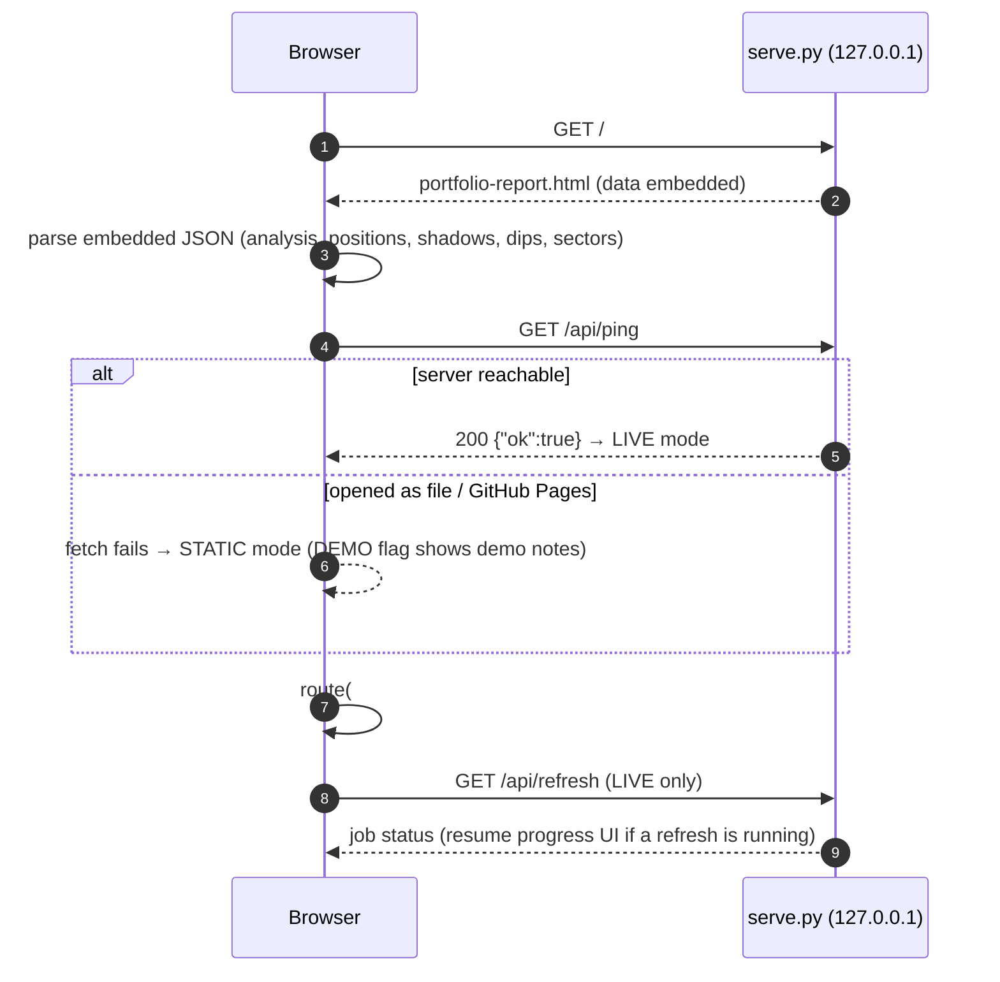
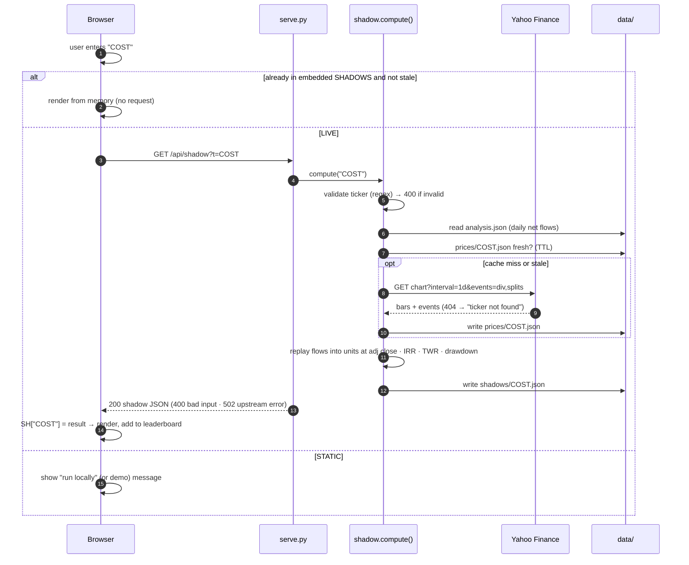
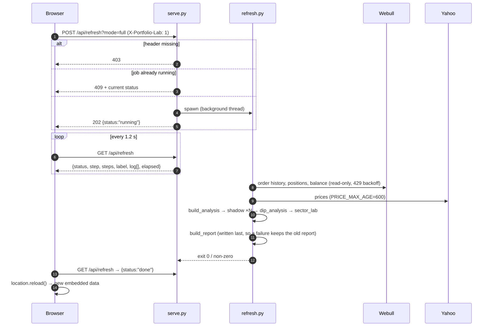
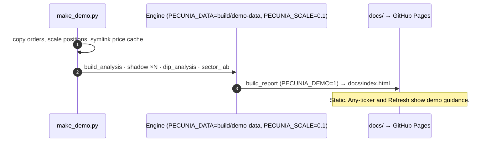
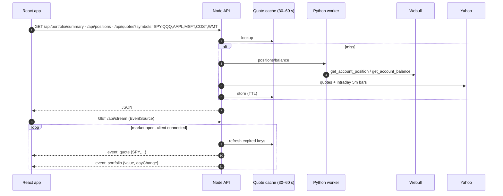
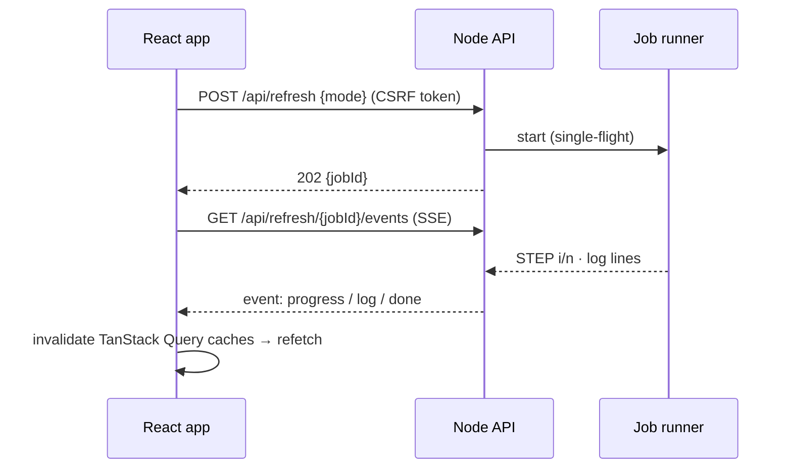

# Request flows

## 1. Page load and mode detection (v1)

Nothing on a page needs a round trip except the ping. Navigation between pages is client-side.

## 2. Compare any ticker (v1)

## 3. Refresh (v1)

## 4. Demo publish (v1)

## 5. Live home dashboard (v2)

## 6. Refresh job with streaming progress (v2)

